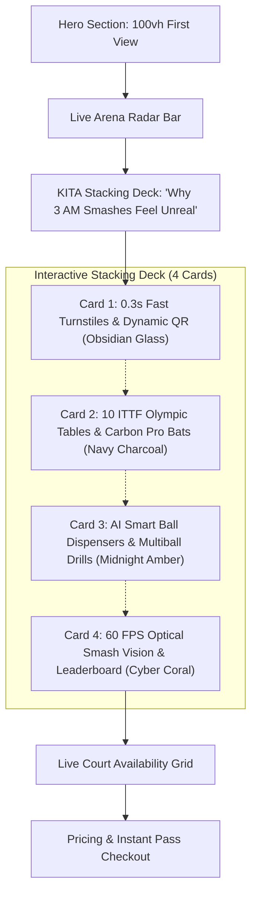

# KITA Stacking Card Architecture & Visual Finish Analysis

> **Target Site:** [KI Training & Assessing (kita.edu.au)](https://kita.edu.au/)  
> **Section Inspected:** `.kit-section` (`Training Built for High-Risk Industries`)  
> **Target Project:** JOMNITTAKU (24/7 Autonomous Smart Table Tennis Arena)

---

## 1. Executive Summary

This document captures the forensic architectural and visual analysis of KITA's interactive stacking card section. The cards produce a distinct tactile, velvety "paper/slate" finish and an intuitive, satisfying card-deck stacking motion as the user scrolls.

Contrary to appearances, the effect uses:
- **Zero canvas elements**
- **Zero SVG noise / grain overlays**
- **Zero heavy JavaScript parallax scroll listeners**

Instead, the experience is driven by **pure CSS `position: sticky` kinematics**, a **locked-hue HSL progressive color ladder**, **negative-spread ambient contact shadows**, and **sub-pixel clipped photography**.

---

## 2. Animation & Stacking Mechanics

### A. The CSS Sticky Stacking Formula
Each card is a child of the `.kit-section` wrapper. The stacking behavior is achieved purely through native CSS variables:

```css
.kit-card {
  position: sticky;
  top: var(--kit-top);
  z-index: var(--kit-step);
  border-radius: 20px;
  overflow: hidden;
  box-shadow: 0 8px 32px -8px hsl(0 0% 0% / 0.25);
  margin-bottom: 24px;
}
```

The offset formula computes a progressive top resting position for each card:
$$\text{top}_i = \text{base\_top} + (i \times \text{step\_offset})$$
Where:
- $\text{base\_top} = 96\text{px}$ (clearing the fixed navbar)
- $\text{step\_offset} = 20\text{px}$ (exposing a physical "folder tab" index header)

### B. Why It Feels So Tactile
As Card 2 scrolls up, Card 1 locks at `top: 96px`. When Card 2 reaches `top: 116px`, it slides smoothly over Card 1. The top 20px of Card 1 remains exposed, exactly resembling a physical Manila folder file or stacked credit cards in a luxury wallet.

---

## 3. The Smooth Color Progression (The Locked-Hue Ladder)

KITA's palette avoids harsh contrast shocks or eye fatigue by strictly locking the color hue between **40° and 46°** (Warm Amber/Gold/Honey), adjusting only saturation and lightness:

```
[Card 1: 96% Lightness] -> [Card 2: 93% Lightness] -> [Card 3: 72% Lightness] -> [Card 5: 14% Lightness]
```

### Forensic Color Table

| Step | Color Name | Exact Computed CSS (`--c-bg`) | Text Color (`--c-text`) | Visual Purpose |
| :--- | :--- | :--- | :--- | :--- |
| **01** | **Warm Ivory Paper** | `#FAF6EE` (`hsl(40 43% 96%)`) | `#0B0E14` (Deep Charcoal) | Soft, organic greeting; zero glare |
| **02** | **Soft Warm Butter** | `#FFF6DA` (`hsl(45 100% 93%)`) | `#1A1206` (Espresso Ink) | Gentle warmth escalation |
| **03** | **Luminous Safety Gold** | `hsl(46 95% 72%)` | `#000000` (Pitch Black) | High-energy focal highlight |
| **04** | **Pastel Sun Amber** | `hsl(42 100% 80%)` | `#1A1206` (Espresso) | Visual bridge |
| **05** | **Espresso Bronze** | `#3A2A0A` (`hsl(40 71% 14%)`) | `#FAF6EE` (Warm Ivory) | Grounding contrast transition |
| **06** | **Obsidian Slate** | `#0A0E14` (`hsl(216 33% 6%)`) | `#FAF6EE` (Warm Ivory) | Final industrial anchor |

---

## 4. The "Texture" Illusion (Micro-Details)

| Detail | Computed CSS Implementation | Optical Effect |
| :--- | :--- | :--- |
| **Negative Spread Shadow** | `box-shadow: 0 8px 32px -8px rgba(0,0,0,0.25)` | Shrinks shadow blur inward. Eliminates muddy dark halos and generates a realistic 3D elevation shelf. |
| **Anti-Aliasing Clip** | `border-radius: 24px; clip-path: inset(0 round 24px);` | Eliminates sub-pixel edge fringe artifacts on 16:9 images across WebKit and Chromium engines. |
| **Card-Wide CTA Inversion** | `.kit-card:hover .kit-cta { background: var(--c-text); color: var(--c-bg); }` | Moving mouse anywhere over the card flips the pill button color without jarring jumps. |
| **Image Micro-Zoom** | `transition: transform 600ms cubic-bezier(.22, 1, .36, 1); transform: scale(1.02);` | Gentle 2% zoom gives the visual an interactive depth cue. |
| **Hairline Edge Definition** | `border: 1px solid var(--c-border)` (`rgba(0,0,0,0.05)`) | Subtly frames the card like laser-cut paper stock. |

---

## 5. Strategic Integration Plan for JOMNITTAKU

### Which Section Should This Replace/Elevate?

In our current `arena_landing_screen.dart`, we have:
1. `_buildHeroSection` (Fullscreen video + instant pass booking)
2. `_buildLiveEnergyTicker` (Real-time arena occupancy radar)
3. `_buildHowItWorksSection` (Step 1-2-3 horizontal/vertical cards)
4. `_buildVibeCultureSection` (Bento grid showcase)
5. `_buildLiveCourtsTeaser` (10 ITTF Court selector)
6. `_buildPricingSection` (Membership tiers)

### Recommended Placement: **The Experience Showcase ("The Vibe & Tech Behind the Arena")**
*Replacing the static `_buildVibeCultureSection` / `_buildHowItWorksSection` hybrid.*

Currently, users scroll through standard bento tiles. By replacing this area with a **4-Card Luxury Stacking Deck**, visitors experience JOMNITTAKU's autonomous features unfolding layer by layer:



### JOMNITTAKU Dark Luxury Color Palette

To adapt KITA's smooth daylight ladder into JOMNITTAKU's dark sports aesthetic:

```dart
// 1. Midnight Turnstiles
Color(0xFF0E131F) // Deep Obsidian Blue
// 2. Olympic ITTF Gear
Color(0xFF131B2E) // Midnight Slate Navy
// 3. AI Ball Dispensers
Color(0xFF1E180E) // Warm Smoked Amber Noir
// 4. Optical Smash Tracking
Color(0xFF221115) // Deep Cyber Coral Noir
```

Each card features:
- Inset 16:9 high-res arena photography with `clipRRect(borderRadius: 24)`.
- Smooth `0 8px 32px -8px` shadow using dark elevation.
- 20px sticky step offset on web and smooth swipe/scroll on mobile.
- Outlined pill CTA that inverts on card hover (`See Court Specs →`).
